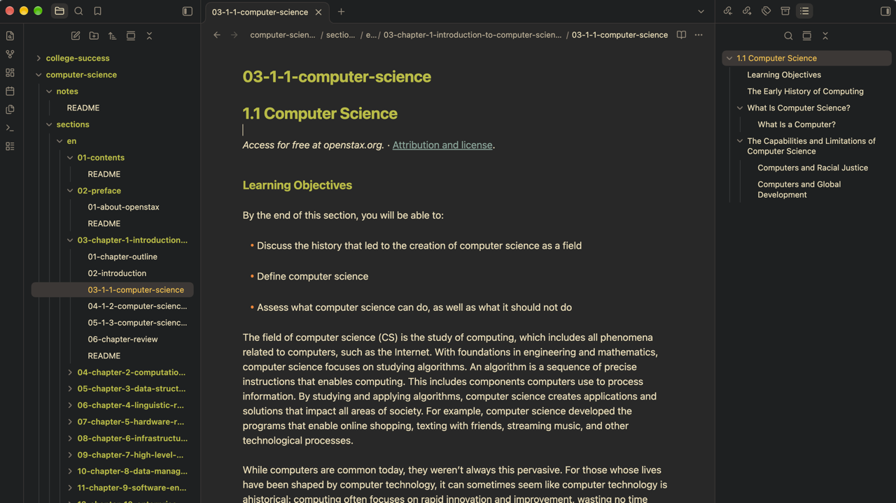
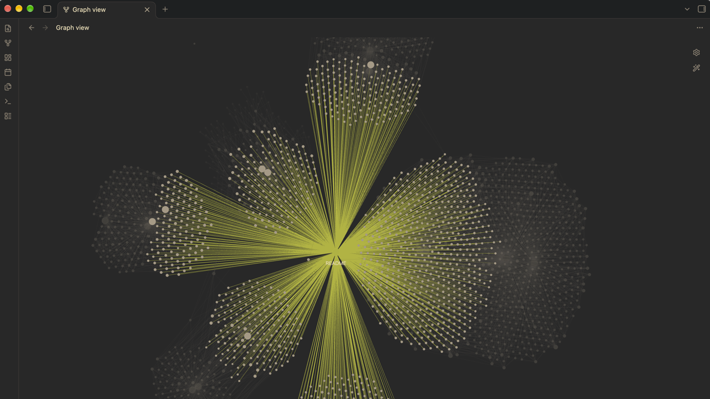
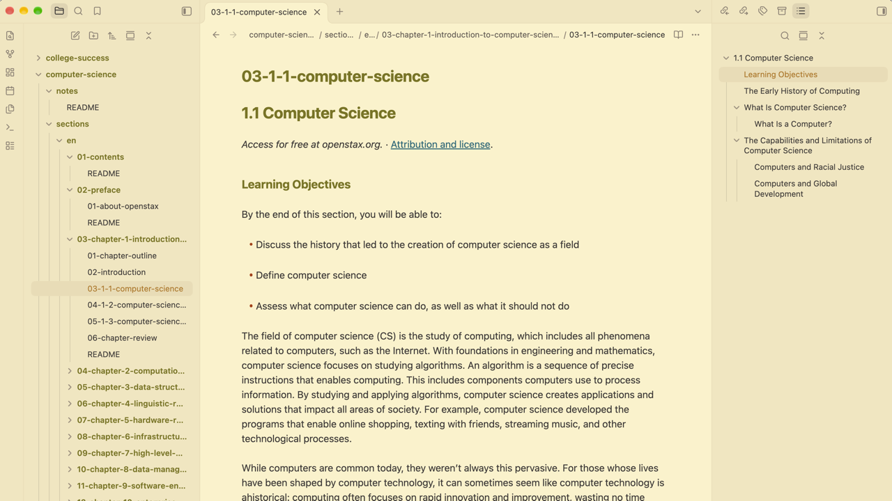
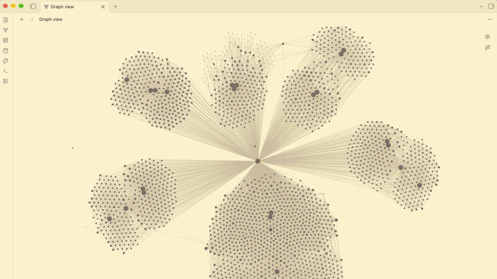

# Gruvbox Calm

**A calm, focused color theme for your notes.**

Warm gruvbox colors, in dark and light, for long-form reading and writing in Obsidian:
notes, journals, study material, documentation, and knowledge bases.

## Benefits

- **Easy on long sessions.** Backgrounds are `#282828` (dark) and `#fbf1c7` (light) and text is `#ebdbb2` and `#3c3836`. The theme never uses pure black or pure white for backgrounds or text.
- **Structure you can see at a glance.** Headings are green and bold, links are blue and underlined, list markers are orange, quotes are gray. Color does the work, so hierarchy reads without extra decoration.
- **Consistent meaning.** The same color means the same thing throughout your notes, so you learn the look once.
- **Stays out of the way.** Nothing moves, so your layout, plugins, and snippets keep working the way they did.


## Preview

Dark:




Light:





## Colors

| Obsidian | Dark | Light |
| --- | --- | --- |
| Editor background | `#282828` | `#fbf1c7` |
| Text | `#ebdbb2` | `#3c3836` |
| Sidebars, ribbon, tab bar | `#1d2021` | `#f2e5bc` |
| Headings, folder names, accent (bold) | `#b8bb26` | `#79740e` |
| Links (underlined) | `#83a598` | `#076678` |
| `Inline code` (italic) on a panel color | `#b8bb26` on `#3c3836` | `#79740e` on `#ebdbb2` |
| `==Highlight==` background | `#fabd2f` | `#b57614` |
| List markers, heading `#`, code punctuation | `#fe8019` | `#af3a03` |
| Faint text, unchecked box, code comments | `#928374` | `#928374` |
| Text selection | `#665c54` | `#bdae93` |
| Code: keywords | `#fb4934` | `#9d0006` |
| Code: strings and functions | `#b8bb26` | `#79740e` |
| Code: numbers and constants | `#d3869b` | `#8f3f71` |
| Code: types | `#fabd2f` | `#b57614` |

## Install

**From the community directory** (once the theme is listed):

1. Open **Settings**.
2. Under **Appearance → Themes**, select **Manage**.
3. Select **Gruvbox Calm**, then select **Install and use**.

**Manually:**

1. Download `theme.css` and `manifest.json` from the latest release on this repository's
   Releases page.
2. Copy both files into `<your vault>/.obsidian/themes/Gruvbox Calm/`. The folder name
   must match the theme name exactly.
3. In Obsidian, open **Settings → Appearance** and select **Gruvbox Calm** from the
   dropdown next to **Themes**.

Requires Obsidian 1.4.5 or newer, the first version that has every CSS variable the
theme sets.

## Customize

You can change the theme's colors without editing it by adding a CSS snippet, which is
Obsidian's way of layering small changes on top of a theme. Obsidian's
[CSS snippets guide](https://help.obsidian.md/snippets) covers it in full, including
mobile. On desktop:

1. Open **Settings**.
2. Under **Appearance → CSS snippets**, select **Open snippets folder**. This is
   `<your vault>/.obsidian/snippets/`, inside the vault's configuration folder.
3. Create a CSS file there, for example `gruvbox-calm.css`, and paste your CSS into it.
4. Back in Obsidian, select **Reload snippets**, then turn the snippet on with its
   toggle.

Once a snippet is enabled, Obsidian applies later edits when you save the file.

Start selectors with `body.theme-dark` or `body.theme-light`. They are more specific
than the theme's own `.theme-dark` and `.theme-light`, so your values win whatever
order the files load in. Obsidian's own variables are listed in its
[CSS variables reference](https://docs.obsidian.md/Reference/CSS+variables/CSS+variables).

### Palette variables

The palette lives in `--gb-*` variables at the top of `theme.css`.

- **Neutrals:** `--gb-bg0`..`--gb-bg4` (backgrounds and borders), `--gb-fg0`..`--gb-fg4`
  (text), and `--gb-side` (sidebars, ribbon, tab bar).
- **Accent colors:** each one has companion variables that must change with it.

| Color | Variables to set together | Used for |
| --- | --- | --- |
| Green | `--gb-green`, `--gb-green-rgb`, `--gb-green-hover`, `--gb-accent-hsl` | Headings, folder names, the accent (buttons, toggles, checkboxes), inline code, code strings and functions, table headers |
| Yellow | `--gb-yellow`, `--gb-yellow-rgb` | `==Highlights==`, warnings, the active file in the sidebar, code types |
| Orange | `--gb-orange`, `--gb-orange-rgb` | List markers, heading `#`, code punctuation and operators |
| Red | `--gb-red`, `--gb-red-rgb` | Code keywords, unresolved links, errors |
| Blue | `--gb-blue`, `--gb-blue-rgb` | Links, code properties |
| Purple | `--gb-purple`, `--gb-purple-rgb`, `--gb-pink-rgb` | Code numbers and constants |
| Aqua | `--gb-aqua`, `--gb-aqua-rgb` | Tags, tag nodes in the graph |
| Gray | `--gb-gray`, `--gb-gray-rgb` | Faint text, code comments, unchecked boxes, the quote bar, hover backgrounds |

- A `-rgb` variable is the same color as a comma-separated triplet, like `254, 128, 25`.
  Callouts and translucent backgrounds (hover, tags) use it, so changing only the hex
  value leaves them on the old color.
- `--gb-accent-hsl` is the green as `hue, saturation%, lightness%`, for example
  `61, 66%, 44%` in dark mode. `--gb-green-hover` is the accent's hover color.
- The theme sets the accent itself, so **Settings → Appearance → Accent color** has no
  effect while it is active. Green is also the heading and code color, so changing
  `--gb-green` moves all of them together.

```css
/* Sidebars use the editor background */
body.theme-dark  { --gb-side: #282828; }
body.theme-light { --gb-side: #fbf1c7; }

/* Quieter list markers */
body.theme-dark,
body.theme-light { --list-marker-color: var(--gb-fg4); }

/* Change an accent: set the color and its -rgb companion together */
body.theme-dark {
  --gb-orange: #d65d0e;
  --gb-orange-rgb: 214, 93, 14;
}
```

## Credits

- Palette: [Gruvbox](https://github.com/morhetz/gruvbox) by morhetz, through the
  [community edition](https://github.com/gruvbox-community/gruvbox) (MIT, Copyright (c)
  2018 Pavel Pertsev).
- Color values, and the choice of which color goes where, follow
  [gruvbox.nvim](https://github.com/ellisonleao/gruvbox.nvim) (MIT, Copyright (c) 2021
  NpX).
- This theme is original CSS and does not copy code from other Obsidian themes.

## License

[MIT](LICENSE)
